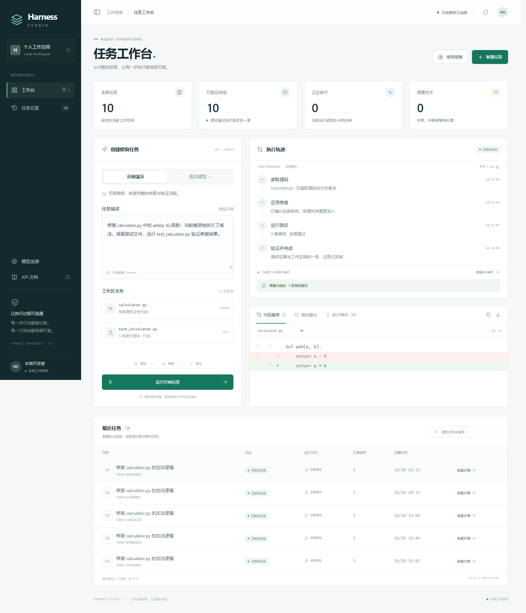

# Deep Agents Workbench

基于 **Deep Agents 0.7.32** 的代码修复任务服务，重点实现 **工具执行日志、故障恢复和结果验证**。

现在包含 **Harness Studio 前端工作台**：任务创建、实时轨迹、源码差异、测试输出、执行事件与历史搜索。前端直接由 FastAPI 提供，不需要单独启动 Node 服务或下载外部字体。



这是个人二次开发项目的可运行起点。上游的 Agent Loop、默认上下文管理和 LangGraph Checkpoint 来自 Deep Agents/LangChain/LangGraph；新增部分是任务服务、受控工具、持久执行意图、文件恢复协议和故障评测。不要把上游能力写成个人原创。

## 快速运行（当前 Windows 环境）

在 PowerShell 中进入本目录：

```powershell
# 本机已创建 .venv 并安装依赖。后续重新安装可用：
py -3.14 -m uv sync --extra dev --frozen

# 复现未经应用中间件修改的上游工具调用循环，无需 API Key
.\.venv\Scripts\harness.exe reproduce

# 跑代码修复闭环：实际读取、修改 calculator.py，并运行 3 条 unittest
.\.venv\Scripts\harness.exe demo

# 启动本地服务，打开 http://127.0.0.1:8000/
.\start.ps1
```

在其他环境使用 Python 3.12+ 和 `uv sync --extra dev --frozen`，然后 `uv run harness ...`。

首页点击「运行示例任务」即可体验。修复完成后，右侧查看执行轨迹，下方切换「代码差异」「测试输出」「执行事件」；点击「任务记录」可搜索历史任务。API 文档仍位于 `/docs`。

「真实模型」模式支持上传同一目录的 Python 文件，需要包含根目录的 `test_*.py`；未配置模型时会显示接入说明。前端不会保存或显示 API 密钥。

**默认是确定性 fixture 模型，不是 LLM。** 它选择固定工具调用，但经过真正的上游 Deep Agents 图、工具中间件、SQLite Checkpoint 与文件/测试执行。它验证工程行为，不代表模型理解能力、通用代码修复成功率或 SWE-bench 成绩。

## 演示一次中断恢复

```powershell
# 在文件已修改、成功结果尚未记账的位置模拟退出；输出包含任务 id
.\.venv\Scripts\harness.exe demo --fault after_effect

# 换一个进程恢复该任务
.\.venv\Scripts\harness.exe resume <任务id>

# 查询执行次数和结果复用情况
.\.venv\Scripts\harness.exe status <任务id>
```

预期：恢复后的任务通过 3 条测试，`metrics.file_write_attempts` 仍为 **1**。恢复会通过文件哈希识别已经发生的修改，而不是重新替换。该指标统计开始执行的写入尝试，不是所有故障条件下的精确磁盘写入计数。

`demo --fault` 使用不可被普通工具异常处理吞掉的模拟故障；下面的 `evaluate` 则在独立 worker 进程中调用 `os._exit(86)`，验证真正的进程退出。

```powershell
.\.venv\Scripts\harness.exe evaluate
.\.venv\Scripts\python.exe -m pytest -q
.\.venv\Scripts\ruff.exe check src tests
```

评测报告保存在 `artifacts/recovery-report.json`。它只包含一个小型修复 fixture 下的四种故障窗口与无故障对照，不能据此声称普遍的恢复率或模型性能提升。

## 二次开发内容

### 1. 任务服务与持久事件

- FastAPI 提供任务创建、状态查询、恢复和工作区结果接口。
- 每个任务拥有独立复制的工作区与 Checkpoint 数据库。
- 应用状态、执行事件与工具日志写入 SQLite（WAL / FULL synchronous）。
- SSE 支持持久事件 ID、`Last-Event-ID` 和断线后的事件补读。
- 每任务使用跨进程文件锁，防止两个 worker 同时操作同一工作区；进程死亡后系统释放锁。

### 2. 工具执行日志与恢复协议

键为 `(task_id, tool_call_id)`，同一调用 ID 携带不同参数时直接阻断。

```text
工具请求
  → 持久化 prepared（原始哈希、目标哈希、预期内容）
  → 记录 started
  → 原子替换文件
  → 持久化 succeeded + 结果
  → 工具结果交回 LangGraph
```

恢复时：

| 当前情况 | 行为 |
|---|---|
| 已有成功结果 | 复用持久结果，不重新执行 |
| 文件仍等于原始哈希 | 执行已持久化的修改意图 |
| 文件等于目标哈希 | 确认之前的修改已完成，补记成功 |
| 两种哈希都不匹配 | 阻断恢复，保留外部修改 |
| 测试已启动，但没有持久结果 | 标记结果不确定，要求明确允许重试 |

`run_tests` 执行的 Python 代码可能产生副作用，所以无法自动认定未知执行“可以安全重复”。确认后可使用：

```powershell
.\.venv\Scripts\harness.exe resume <任务id> --retry-uncertain-tests
```

文件原子替换与哈希对账针对本地文件的受限编辑场景；不承诺对任意 Shell、网络 API 或外部系统实现 exactly-once，也不覆盖磁盘损坏、主机掉电与网络文件系统语义。

### 3. 基于证据的任务完成判定

- 模型回复“完成”不会直接将任务标为成功。
- 必须有真实执行的测试结果、非零测试数量、成功退出码，以及测试时与最终工作区一致的内容指纹。
- 模型不能通过本项目工具修改 `test_*.py` 测试文件。
- 测试进程有超时，输出只向模型返回尾部。

## 接入真实模型

```powershell
Copy-Item .env.example .env
```

在本地 `.env` 中填写；不要把密钥提交到 Git 或发送到聊天：

```dotenv
WORKBENCH_MODEL_MODE=openai
OPENAI_API_KEY=你的密钥
OPENAI_MODEL=服务商提供的支持工具调用的模型名
OPENAI_BASE_URL=服务商文档中的兼容接口地址
```

`openai` 表示 OpenAI-compatible 接口模式，不限制模型服务商。代码通过 LangChain 的 `ChatOpenAI` 适配器调用，不保证所有兼容服务的行为完全相同。

准备一个小型、可信的 Python 目录，包含业务代码与根目录的 `test_*.py` unittest 文件：

```powershell
.\.venv\Scripts\harness.exe run --workspace .\examples\calculator --prompt "修复 calculator.py 中 add 函数的错误，并运行 test_calculator.py 验证。"
```

源文件会复制到任务工作区，不修改传入目录。此版本只接收少量 UTF-8 文件，没有任意 Git 仓库克隆、依赖自动安装、通用 Shell、联网搜索或完整项目构建能力。

**当前没有 OS 级沙箱。** 文件路径限制和独立目录不能约束 Python 测试代码的所有行为。只运行自己信任的源码和测试，服务默认绑定 `127.0.0.1`。面向不可信仓库时，应先开发容器执行后端，再开放任务入口。

## API

| 接口 | 作用 |
|---|---|
| `POST /tasks/demo` | 创建并执行无需密钥的演示任务 |
| `POST /tasks` | 提交 prompt、files 和可选 model_mode |
| `GET /tasks` | 查询任务列表 |
| `GET /tasks/{id}` | 状态、执行次数、结果、错误 |
| `POST /tasks/{id}/resume` | 恢复任务，body 可传 retry_uncertain_tests |
| `GET /tasks/{id}/events?after=0` | 分页查询持久事件，每页最多 500 条 |
| `GET /tasks/{id}/stream` | SSE 事件补读与实时订阅 |
| `GET /tasks/{id}/files` | 查看修复后的源码与测试 |
| `GET /tasks/{id}/diff` | 查看保存的原始源码与当前源码的差异 |

新任务的原始源码在创建时与任务记录一同保存。旧任务没有版本快照时，页面只显示当前源码，并明确标记无法比较原始版本。

```powershell
$task = Invoke-RestMethod -Method Post -Uri http://127.0.0.1:8000/tasks/demo
Invoke-RestMethod -Uri ("http://127.0.0.1:8000/tasks/" + $task.id)
```

## 目录

```text
src/harness_workbench/
  agent.py        Deep Agents 组装、自定义工具中间件
  tools.py        受控工具、哈希校验、原子写、测试执行
  store.py        应用数据库、工具日志、持久事件
  service.py      任务生命周期、文件锁、Checkpoint 恢复、成功判定
  api.py          FastAPI 与 SSE
  models.py       确定性 fixture 和真实模型适配
  evaluation.py   子进程故障注入评测
  reproduce.py    未修改上游图的工具调用复现
  static/         本地前端（HTML / CSS / JavaScript）
tests/            恢复、冲突、路径、测试执行、图与 API 验证
docs/             架构、实测结果与简历表达
upstream/         官方固定版本源码，只读参考，不纳入本项目 Git
UPSTREAM.json     上游版本、来源和压缩包 SHA256
uv.lock           锁定依赖
```

上游源码入口：`upstream/deepagents-deepagents-0.7.32/libs/deepagents/deepagents/graph.py`。先读同目录所在仓库的 `libs/ARCHITECTURE.md`，再沿中间件栈追踪调用。

重新获取源码：`python scripts/fetch_upstream.py`，校验已下载的压缩包：`python scripts/fetch_upstream.py --check`。

## 可选的前端浏览器验证

运行应用本身不需要安装 Node 依赖。需要重跑前端交互测试时，确保本地服务已启动：

```powershell
npm.cmd ci
npm.cmd run test:ui
```

测试使用独立无头浏览器，不读取个人浏览器配置。默认查找本机 Chrome/Edge；其他位置可通过 `CHROME_PATH` 指定，本地服务地址可通过 `WORKBENCH_UI_URL` 指定。测试会创建正常与中断的演示任务，生成截图、`artifacts/ui-report.json` 和 `artifacts/ui-recovery.json`；恢复测试要求服务使用项目的同一份 `.env` 与数据目录。

## 继续发展为求职项目

建议先阅读 [架构说明](docs/ARCHITECTURE.md)、[验证记录](docs/VALIDATION.md) 和 [简历与面试准备](docs/RESUME.md)。真实模型任务集与上下文策略优化尚未完成，不能写成已有成绩。

