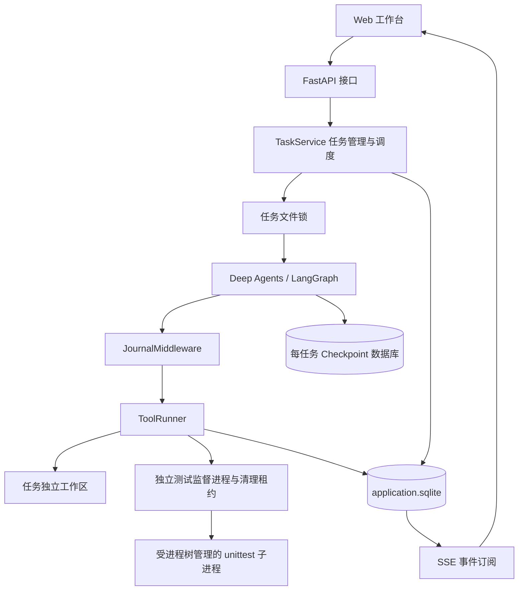
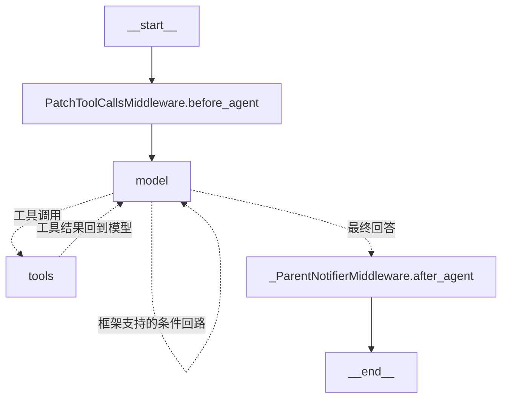
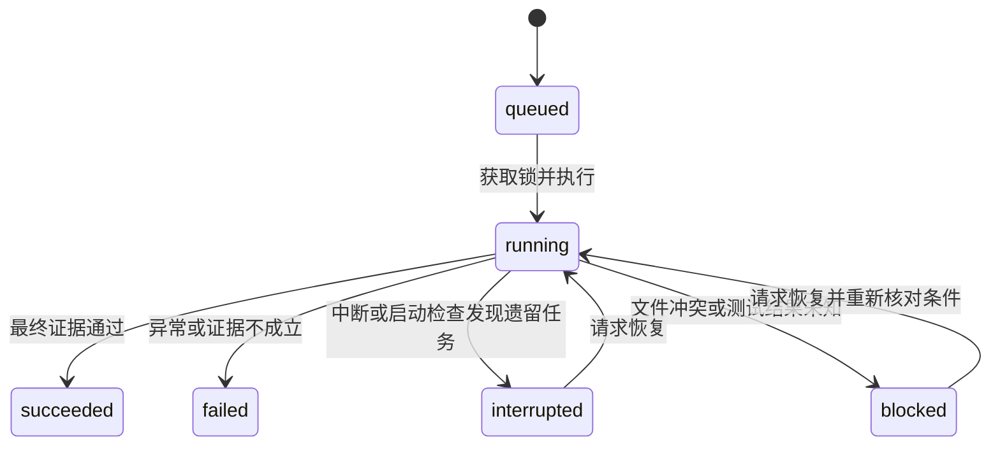

# Harness Studio

**支持中断恢复、工具执行追踪与测试验证的 Agent 代码修复工作台。**

用户提交修复要求、Python 源码和测试文件，系统组织 Agent 完成“读取代码 → 修改文件 → 执行测试”，并在 Web 页面展示执行轨迹、代码差异和测试结果。项目围绕进程中断、重复工具调用、文件冲突和验证结果失效问题，实现任务持久化、工具执行日志、文件修改恢复协议与基于执行证据的完成判定。


## 功能概览

| 能力 | 实现方式 |
|---|---|
| 代码修复闭环 | 读取文件、精确替换、执行 unittest，将工具结果返回 Agent |
| 任务中断恢复 | LangGraph Checkpoint 恢复图状态，工具日志核对实际操作 |
| 文件修改恢复 | 修改前后 SHA256 对账，识别未执行、已生效与外部冲突 |
| 重复调用防护 | 以 `(task_id, tool_call_id)` 关联调用，复用已保存的成功结果 |
| 执行互斥 | 每任务跨进程文件锁，防止两个执行者并发操作同一工作区 |
| 独立最终验收 | Harness 运行原始完整测试清单，核对测试内容和最终工作区指纹 |
| 执行可视化 | 任务历史、执行时间线、源码差异、测试输出和持久事件 |
| 子进程生命周期 | 独立监督进程、所有者管道与清理租约；Worker 退出后清理测试进程树 |
| 故障验证 | 覆盖文件故障窗口、Agent 测试和最终验收运行时 Worker 退出 |

默认 `demo` 使用确定性模型，无需密钥即可体验完整工程流程；`openai` 模式通过兼容工具调用的接口执行真实模型任务。当前已验证演示模式与恢复机制，真实模型端到端修复效果尚未验证。

## 快速开始

需要 Python 3.12+、Git 和 uv。Windows 已验证环境为 Python 3.14。前端随 FastAPI 提供，无需 Node 构建。

```powershell
git clone https://github.com/CKKKK101/agent-harness-workbench.git
cd agent-harness-workbench
uv sync --extra dev --frozen
Copy-Item .env.example .env
uv run harness serve --port 8000
```

已有 `.env` 时保留现有配置，不必重复复制。当前已安装的本地环境也可以直接运行 `./start.ps1`。

- 工作台：<http://127.0.0.1:8000/>
- API 文档：<http://127.0.0.1:8000/docs>
- 健康检查：<http://127.0.0.1:8000/health>

点击“运行示例任务”，系统会修复 `calculator.py` 的加法错误并执行 3 条 unittest。页面支持查看修改前后内容、测试输出、事件和历史任务。命令行也可运行：

```powershell
uv run harness demo
uv run harness status <任务id>
```

演示模型按照固定逻辑选择工具，但经过实际 Deep Agents 执行图、应用工具中间件、SQLite Checkpoint 和真实文件/测试执行。它验证工程行为，不代表通用模型代码修复能力。

## 系统架构



- **交互层**：提交任务、查询状态、订阅事件、比较代码与展示测试输出。
- **执行编排层**：创建工作区、获取锁、恢复图状态、执行 Agent、校验完成证据。
- **操作与持久化层**：校验参数、记录修改意图、执行文件操作与测试，保存调用结果。

Agent 编排采用 Deep Agents 0.7.32 与 LangGraph。项目应用代码实现任务服务、工具恢复协议、结果验证、接口及前端。依赖来源与许可见 [THIRD_PARTY_NOTICES.md](THIRD_PARTY_NOTICES.md)。

## LangGraph 执行图与节点

### 图组装入口

入口位于 [agent.py](src/harness_workbench/agent.py) 的 `build_agent()`：

```python
create_deep_agent(
    model=create_model(mode),
    system_prompt=SYSTEM_PROMPT,
    tools=[inspect_file, replace_text, run_tests],
    middleware=[JournalMiddleware(runner)],
    checkpointer=checkpointer,
)
```

当前通过工厂编译图，使用模型与工具之间的动态循环。读取、修改、测试是工具，不是三个手写的独立图节点。真实模型可以根据结果决定下一步；演示模型则为固定样例生成确定调用序列。

### 实际编译出的节点与边

以下根据当前锁定环境中 `agent.get_graph()` 的实际输出整理。框架内部名称可能随依赖变化，以 `uv.lock` 对应环境为准。



| 节点 | 职责 | 项目中的作用 |
|---|---|---|
| `__start__` | 图入口 | 接收初始输入，恢复由检查点决定继续位置 |
| `PatchToolCallsMiddleware.before_agent` | 对历史中缺少结果的工具调用补充错误消息 | 框架消息完整性处理，不负责确认文件修改是否发生 |
| `model` | 根据消息调用模型，产生工具调用或最终回答 | 提供修复约束提示词、模型适配与调用包装 |
| `tools` | 分发工具调用，产生 ToolMessage | 通过应用中间件交给 ToolRunner 执行与恢复 |
| `_ParentNotifierMiddleware.after_agent` | 框架的父 Agent 通知钩子 | 当前同步路径为透传，不表示实现了多 Agent 协作 |
| `__end__` | 图结束 | 服务层随后验证结果，图结束不等于任务成功 |

`model → model` 是编译图暴露的条件回路，不是每次修复都会经过。`JournalMiddleware` 使用 `wrap_model_call` 和 `wrap_tool_call` 包装钩子，不会作为独立节点出现在图中。任务创建、锁管理和最终验证位于图外服务层。

### model：决策与工具选择

主要输入是 `messages` 消息历史，包括用户需求、此前模型响应及工具结果。系统提示词要求先读取、使用最新哈希做最小修改、运行测试，并禁止通过修改测试掩盖错误。

- `demo`：`DemoRepairModel` 继承 `BaseChatModel`，生成符合工具调用协议的 AIMessage，不调用外部模型。
- `openai`：通过 `ChatOpenAI` 连接兼容接口，使用 Chat Completions 路径，模型需支持工具调用。
- 响应含 `tool_calls`：框架将调用路由给 `tools`。
- 响应为最终回答：进入结束路径，服务层再核对完成证据。

`JournalMiddleware.wrap_model_call()` 在调用模型前只保留三个应用工具，避免框架其他文件、Shell、子 Agent 工具绕过应用的恢复协议。调用完成后保存 `model.completed` 事件。

### tools：参数校验与统一执行

```text
tools
  └─ JournalMiddleware.wrap_tool_call()
       ├─ 工具白名单校验
       ├─ Pydantic 参数校验
       ├─ ToolRunner.execute(call_id, name, arguments)
       └─ 返回带原 tool_call_id 的 ToolMessage
```

| 工具 | 参数 | 行为 |
|---|---|---|
| `inspect_file` | `path` | 返回 UTF-8 内容和 SHA256 |
| `replace_text` | `path, expected_sha256, old, new` | 校验版本，要求旧文本恰好出现一次，持久化后执行替换 |
| `run_tests` | `target` | 接收根目录 test_*.py 文件名，返回退出码、测试数量、输出与指纹 |

可修正的参数或路径错误返回 `recoverable_input_error`，让模型调整调用。恢复冲突与未知执行结果向外传播，将任务设为 `blocked`。

### 一次完整消息流

```text
HumanMessage：修复 add 函数，并执行测试
AIMessage：inspect_file(calculator.py)
ToolMessage：代码与 SHA256
AIMessage：replace_text(..., old="return a - b", new="return a + b")
ToolMessage：修改后的 SHA256 与 changed
AIMessage：run_tests(test_calculator.py)
ToolMessage：退出码、测试数量、verified 与工作区指纹
AIMessage：最终说明
```

这描述示例轨迹，而非固定节点链。真实模型可在工具约束内重新读取、调整修改或根据测试失败继续处理。默认 `recursion_limit=40` 限制图执行深度。

## Checkpoint 与恢复入口

[service.py](src/harness_workbench/service.py) 为每个任务创建独立 SQLite Checkpoint 数据库，用任务 ID 关联图线程：

```python
config = {
    "configurable": {"thread_id": task_id},
    "recursion_limit": 40,
}
```

执行前通过 `agent.get_state(config)` 查询快照：

| 状态 | 处理 |
|---|---|
| 没有已有状态 | 以用户需求构造初始 messages，启动图 |
| 已有状态且仍有后续位置 | 调用 `agent.invoke(None, config)` 继续执行 |
| 已有状态且没有后续位置 | 复用最终图结果，补做应用层完成验证 |

第三种情况处理“图已完成，但应用完成状态尚未提交”的中断窗口。Checkpoint 保存图状态，工具日志核对实际操作；数据库与文件系统之间没有统一原子事务，不能仅靠图快照推断文件是否已经修改。

## 核心机制设计

### 1. 任务生命周期与执行互斥

创建任务时校验内容，复制文件到独立工作区，并在数据库事务中保存任务记录和初始源码。线程池默认最多两个 worker，每任务文件锁防止两个执行者同时推进同一任务。



服务启动时检查遗留 `running` 任务，只有获取到锁才标记 `interrupted`；锁仍被占用则不接管。此过程暴露恢复入口，不自动重跑任务。已完成的 succeeded、failed 任务不可再次恢复，需要新建任务。文件冲突不会因再次点击恢复而强制覆盖。当前互斥针对本机文件系统，不是分布式调度。

### 2. 工具调用日志与重复执行防护

工具日志主键为 `(task_id, call_id)`，保存工具名称与规范化 JSON 参数。相同 ID 携带不同名称或参数直接触发冲突。

```text
prepared：意图已保存
    ↓
started：开始执行，executions 加一
    ↓
succeeded：结果已持久化
```

如果已有成功结果，复用结果并增加 `reuses`。`executions` 统计开始执行的尝试次数，并不是全部潜在故障下精确的磁盘写入次数。

### 3. 文件修改恢复协议

首次编辑校验 `expected_sha256`，确认文件没有在读取后改变。随后持久化 `before_hash`、`after_hash`、预期内容与结果。

```text
保存 prepared
    ↓
核对当前文件哈希
    ↓
保存 started
    ↓
同目录临时文件写入 → flush → fsync → 再次核对目标哈希 → os.replace
    ↓
保存 succeeded 与结果
    ↓
ToolMessage 返回图
```

| 恢复时的观察 | 决策 |
|---|---|
| 已有成功结果 | 复用结果，不重新执行 |
| 当前内容等于 before_hash | 执行已保存的修改意图 |
| 当前内容等于 after_hash | 确认修改已生效，补记成功并复用 |
| 两种哈希都不匹配 | 阻断恢复，保留外部修改 |

原子替换降低进程退出时文件部分写入的风险；哈希对账解决文件已改、成功结果还未保存的窗口。临时文件落盘后再次检查目标哈希，能检测这一阶段已经发生的变更，但最后检查与 `os.replace` 之间仍有 TOCTOU 窗口，**不是文件系统级原子 CAS**。

执行期间工作区由任务独占：所有协作执行者必须经过任务锁和受控工具，不支持编辑器、外部脚本或其他不遵守锁协议的进程同时修改工作区。这是执行契约，不是目录权限强制隔离。冲突保护针对核对时已可见的变更，不能保证保留检查后发生的全部外部写入；回归测试明确演示了这个边界。

本协议未验证主机掉电、磁盘损坏和网络文件系统，也不承诺外部接口 exactly-once。

### 4. 测试执行与未知结果

使用参数数组启动测试，不拼接 Shell 命令：

```text
python -I -m unittest discover -s . -p test_calculator.py
```

默认超时 20 秒。独立监督进程先取得测试清理租约、收到 Worker 的启动授权，才放行测试。Worker 保持一条管道打开，Worker 退出产生 EOF 后，监督进程清理测试进程树，完成后释放租约。

Windows 使用 Job Object 管理测试及派生进程，内部启动入口在加入 Job 前不执行工作区代码；清理时终止整个 Job，等待活跃进程数归零。POSIX 分支使用进程组，当前本轮仅在 Windows 实测。新执行者进入图、工具和最终验收前必须等待清理租约，超时则阻断。

监督进程异常退出或清理未确认时保留 `.tests.uncertain` 标记，阻断后续执行；即使允许测试重试也不能绕过。需要人工核实进程已停止后处理标记，不根据可能复用的 PID 自动终止进程。该机制不约束恶意测试主动逃离进程组等行为，不是安全沙箱。

子进程环境经过筛选，输出写临时文件并只返回末尾 8000 字节，避免管道积压；当前没有磁盘输出配额。

当调用为 started 却没有结果时，无法确认测试是否运行及产生副作用，默认阻断；检查后可显式允许重跑：

```powershell
uv run harness resume <任务id> --retry-uncertain-tests
```

应用编辑工具拒绝修改 test_*.py、conftest.py、pytest.ini。路径约束是目录访问限制，**不是 OS 沙箱**；Python 测试本身仍有宿主进程权限，只运行可信源码与测试。

### 5. 基于证据的完成判定

Agent 的 `run_tests` 可运行一个测试文件，为修复过程提供反馈。图结束后，`TaskService._finalize()` 运行独立最终验收，不再将 Agent 最近一次通过的部分测试直接作为成功依据。

Harness 从 `source_files` 初始快照提取所有以 `test_` 开头、以 `.py` 结尾的文件作为固定清单，包括嵌套与隐藏目录。内部 `test_suite.py` 显式加载全部文件并组合 unittest 测试集，不依赖默认 discover 是否遍历隐藏目录。执行前核对原始测试内容，修改或删除测试会阻断；新生成的测试不能替代原始清单，也不自动扩大验收范围。

验收使用内部 `harness_acceptance` 日志与预留调用 ID，不作为模型工具暴露。恢复时可复用验收结果，但仍核对清单和最终指纹；验收结果未知同样要求显式允许重试。API 与三个模型工具的参数格式保持不变；`metrics.tool_calls` 包含独立验收，因此默认示例现在是 4 次。

成功必须同时满足：

1. 测试退出码为 0。
2. 实际执行测试数量大于 0。
3. 测试前后工作区指纹一致。
4. 测试结果的指纹与最终工作区一致。

模型回复“完成”不是唯一依据。工作区指纹包含普通隐藏文件和隐藏目录，仅排除明确缓存 `__pycache__`、`.pytest_cache`、`.ruff_cache` 与保留的 `.harness-write-*` 临时路径；应用工具同样禁止访问这些排除路径。文件查询采用相同缓存排除规则。

修改隐藏配置也会使旧测试证据失效。验收证明的是原始 unittest 清单在当前状态下通过，不保证需求完全正确，也不能防止恶意测试伪造输出；当前仍要求代码可信。

### 6. 持久事件与源码快照

事件保存到 SQLite，以递增 ID 排序。SSE 支持 `after` 和 `Last-Event-ID`，先补读历史，再每 0.5 秒查询增量。任务进入终止或等待恢复状态且事件读完后关闭流。

前端结合事件订阅与任务状态查询展示结果。代码差异来自创建时的原始快照和当前文件；没有快照的旧任务返回 `baseline_available=false`，不构造虚假原始版本。

事件、任务状态与文件更新并非同一个事务提交。事件用于展示与排查，恢复依据工具日志、检查点及文件状态共同判断。

## 数据存储

```text
.workbench/
  application.sqlite           任务、工具日志、事件、初始源码
  checkpoints/<任务id>.sqlite  每任务图检查点
  locks/<任务id>.lock          执行互斥
  locks/<任务id>.tests.lock    测试清理租约
  locks/<任务id>.tests.uncertain  清理未确认时的阻断标记
  workspaces/<工作区id>/       独立源码和测试副本
```

| 表 | 内容 |
|---|---|
| tasks | 需求、模型模式、工作区、状态、尝试次数、结果与错误 |
| tool_calls | 调用 ID、参数、状态、修改意图、结果、执行与复用计数 |
| events | 任务 ID、事件类型、JSON 数据和时间 |
| source_files | 任务创建时的文件路径和内容 |

应用数据库启用 WAL，连接设置 synchronous=FULL 和忙等待超时。图检查点由 SqliteSaver 管理。运行数据目录被 Git 忽略。

## 中断恢复演示与故障点

```powershell
# 文件修改后、成功结果保存前模拟中断，记下输出任务 id
uv run harness demo --fault after_effect
# 新进程恢复
uv run harness resume <任务id>
uv run harness status <任务id>
```

预期最终通过 3 条测试，`metrics.file_write_attempts` 仍为 1，恢复利用哈希识别已生效修改。

| 故障参数 | 位置 | 检查目标 |
|---|---|---|
| after_prepare | 修改意图保存后 | 从意图继续修改 |
| after_effect | 文件修改后、结果保存前 | 哈希确认副作用已发生 |
| after_journal | 成功结果保存后、返回图前 | 复用持久结果 |
| after_graph | 图结束后、应用完成验证前 | 补做完成验证 |
| after_test_started | 记录测试开始后、启动子进程前 | 未知结果阻断与显式重试 |

`demo --fault` 使用模拟故障；`evaluate` 对前四个中断窗口使用独立 worker 与 `os._exit(86)`，验证实际进程退出。

## 接入真实模型

在本地 `.env` 中设置后重启：

```dotenv
WORKBENCH_MODEL_MODE=openai
OPENAI_API_KEY=你的密钥
OPENAI_MODEL=支持工具调用的模型名
OPENAI_BASE_URL=服务商的兼容接口地址
```

openai 表示兼容接口模式，不限定服务商，具体兼容性需实际验证。健康接口仅返回配置状态与模型名称，不返回密钥。前端真实模型入口支持上传 Python 文件，需包含根目录 test_*.py unittest 文件。

```powershell
uv run harness run --workspace ./examples/calculator --prompt "修复 calculator.py 中 add 函数的错误，并运行 test_calculator.py 验证。"
```

源文件复制后执行，不直接编辑原目录。当前任务允许 1–30 个 UTF-8 文件，总上传内容不超过 512000 字节，单文件上限 256000 字节。未实现任意仓库克隆、依赖自动安装、通用 Shell、联网搜索或容器运行环境。

## API

| 方法与路径 | 用途 |
|---|---|
| GET /health | 服务与模型配置状态 |
| POST /tasks/demo | 创建并调度演示任务，返回 202 |
| POST /tasks | 提交 prompt、files 和可选 model_mode |
| GET /tasks | 查询任务列表 |
| GET /tasks/{id} | 状态、结果、错误与执行指标 |
| POST /tasks/{id}/resume | 恢复，可传 retry_uncertain_tests |
| GET /tasks/{id}/events?after=0 | 按 ID 补读事件，每页最多 500 条 |
| GET /tasks/{id}/stream | SSE 历史补读与增量订阅 |
| GET /tasks/{id}/files | 当前源码和测试 |
| GET /tasks/{id}/diff | 原始与当前源码及变更类型 |

```powershell
$task = Invoke-RestMethod -Method Post -Uri http://127.0.0.1:8000/tasks/demo
Invoke-RestMethod -Uri ("http://127.0.0.1:8000/tasks/" + $task.id)
```

任务创建配置或内容错误返回 422，恢复已完成任务或任务锁冲突返回 409，不存在的任务返回 404。服务默认绑定 127.0.0.1，尚无多用户认证和租户隔离。

## 验证与评测

历史验证与本轮 2026-10-29 回归见 [验证记录](docs/VALIDATION.md) 和 [可靠性契约](docs/RELIABILITY.md)。本轮结果：

| 检查 | 结果 |
|---|---|
| 后端自动化测试 | 55 项通过，包含审查后累计 26 项新增回归 |
| 前端浏览器检查 | 11 项通过，含完整验收失败展示和未知验收重试 |
| Worker 在测试运行时退出 | Agent 测试、独立验收两个实测场景通过，派生进程停止 |
| 子进程恢复 | 正常对照与四类中断，共 5/5 场景通过 |
| 示例文件写入尝试 | 每个场景均为 1 |
| 响应式布局 | 1440px 桌面与 390px 窄屏 |
| 真实模型适配 | 模拟 HTTP transport 协议测试通过 |
| 真实模型修复效果 | 尚未完成端到端验证 |

新增 [GitHub Actions](.github/workflows/ci.yml)：Ubuntu/Windows × Python 3.12/3.14 运行后端、静态检查和恢复评测，Ubuntu 运行浏览器检查并保存构件。工作流配置不等于运行通过；Linux 当前等待远端实际执行。本轮本地复审结论及源码报告见 [REVIEW.md](docs/REVIEW.md)。

恢复评测仅使用一个确定性计算器样例，不代表真实模型成功率、通用恢复率或生产负载表现。测试还覆盖文件冲突、调用参数冲突、路径逃逸、未知测试结果、空测试、超时、任务锁与接口输入校验。

```powershell
uv run pytest -q
uv run ruff check src tests
uv run harness evaluate
```

恢复报告输出到 artifacts/recovery-report.json。重跑浏览器检查前先启动服务：

```powershell
npm.cmd ci
npm.cmd run test:ui
```

使用独立无头 Chrome/Edge，不读取个人浏览器配置。可设置 CHROME_PATH 和 WORKBENCH_UI_URL。截图与报告输出到 artifacts/，恢复检查要求使用同一份环境配置和数据目录。

## 代码导航

```text
src/harness_workbench/
  agent.py        图组装、提示词、工具声明与 JournalMiddleware
  models.py       确定性模型与真实模型适配
  service.py      任务调度、锁、Checkpoint 恢复与完成验证
  tools.py        工具日志、哈希对账、原子写入与独立验收
  execution.py    监督进程、所有者管道、清理租约与进程树管理
  test_process.py 加入受控进程树后启动测试的内部入口
  test_suite.py   加载原始完整测试清单
  store.py        应用数据库、工具日志、事件与初始快照
  faults.py       故障注入与恢复异常
  api.py          FastAPI、静态资源与 SSE
  config.py       环境配置
  cli.py          命令行入口
  evaluation.py   子进程退出与恢复评测
  reproduce.py    原始框架工具调用循环验证
  static/         前端 HTML、CSS、JavaScript 与图标
examples/calculator/  示例源码和测试
tests/                后端测试
scripts/              浏览器与接口验证、参考源码获取
docs/                 架构、验证记录与截图
UPSTREAM.json         框架参考源码版本与校验信息
uv.lock               依赖锁定
```

建议按 api.py → service.py → agent.py → tools.py → store.py 阅读，再结合 evaluation.py 观察各故障窗口。

参考源码获取：`python scripts/fetch_upstream.py`；归档校验：`python scripts/fetch_upstream.py --check`。upstream/ 仅供本地阅读，不纳入 Git，也不是安装项目的必要条件。

## 后续方向

- 接入真实模型，构建多任务修复集，记录完成率、工具调用次数、耗时与成本。
- 引入容器执行后端，提供资源、文件及网络隔离。
- 扩展工具恢复协议，逐项定义可重试条件与结果核对方式。
- 增加认证、任务访问控制与数据保留策略。

## 许可与依赖

本项目代码采用 [MIT License](LICENSE)。依赖来源与许可见 [THIRD_PARTY_NOTICES.md](THIRD_PARTY_NOTICES.md)，框架参考版本见 [UPSTREAM.json](UPSTREAM.json)。
